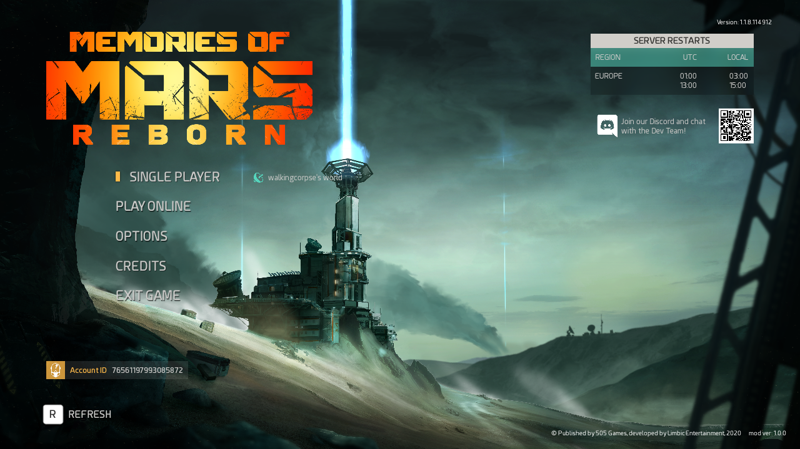

# MEMORIES OF MARS: REBORN

**The survival game the servers left behind, playable again.**

&nbsp;

&nbsp;

---

Memories of Mars lost its official servers in June 2024, taking multiplayer, the menu's online features and the Steam
achievements with them. **Reborn** puts them back: everything runs on your own PC, and your friends can drop into your world.

## Features

| | |
|---|---|
| **Single player** | Press **SINGLE PLAYER** on the main menu: straight into your world, even if you press it the moment the menu appears. |
| **Play with friends** | In **PLAY ONLINE** you see your friends' worlds, plus an **`Invite <friend name>`** row for every friend who is online: select it, press JOIN, and they get a Steam invite. Or accept a Steam "Join Game". |
| **Your saves** | The world and every player's character are saved on the host's PC. Start the game again and carry on. |
| **Achievements** | Unlocks are saved and written to Steam again. Works in your own world too (v1.1.0 fixed the world server never counting stats). |
| **Plugins** | Small add-ons that ship with Reborn, each with an on/off switch in the new **PLUGINS** screen on the Esc menu: a **minimap** (top right, turns with you, shows your pins and alliance mates), **map pins and alliance mates on the compass**, **map zoom up to 32x**, a **detailed map** with terrain shading and **resource dots**. Changes apply the next time the game starts. |
| **Built into the game** | REBORN is in the title logo and the mod version sits in the corner of the main menu. No overlay, no extra window, works in fullscreen at any resolution. |
| **Updates itself** | Checks this page when the game starts and installs new versions. |
| **Fully reversible** | Run the setup again and press **Uninstall** to put the game back exactly as it was. |

## Install

1. Install **Memories of Mars** from Steam.
2. Download **[MoMReborn-Setup.exe](../../releases/latest)** and run it. It finds your game by itself.
3. Press **Play** in Steam. That's it.

Your friends do the same, then you can play together.

> **First start:** Reborn downloads the game's dedicated server from Valve (about 800 MB) before the game opens, with a progress window. Only the person hosting needs it.

## Playing with friends

1. **Host:** just play. Once your world is up, Reborn opens the ports on your router and tells Steam you're hosting.
2. **Invite someone:** in **PLAY ONLINE**, select **`Invite <friend name>`** and press **JOIN**. They get a Steam invite; accepting it starts their game and joins your world.
3. **Join someone:** a friend who is hosting shows up as **`<friend name>'s world`** in PLAY ONLINE. Select it and press JOIN.
4. **Continue later:** the host starts the game again (the world loads from their PC); friends join the same way and get their characters back.
   Your friend can't continue your world when you're offline: your PC is the server.

Everyone needs Reborn installed.

## How it works

Reborn starts a small local replacement for the game's dead online service, runs the publisher's own free dedicated server
on your PC, and edits a few of the game's files so the menu says what it should. Steam friends who are playing Reborn
find each other through Steam, so there is nothing to configure.

<b>What exactly does the installer change?</b>

- Swaps Steam's `Launch_Game.exe` for the Reborn launcher (the original is kept as `Launch_Game.original.exe`).
- Adds a patch pak next to the game's own pak (`pakchunk0-WindowsNoEditor_reborn_P.pak`) with the changed menu files, built on your PC from your own copy of the game.
- Patches 2 bytes of `MemoriesOfMars.exe` so the game accepts that unsigned pak (the original is kept as `MemoriesOfMars.exe.reborn-original`).
- Adds one line to the game's user `Engine.ini` so it talks to the local service.
- Only while at least one plugin that runs code in the game is switched on: copies `dwmapi.dll` and a `ue4ss` folder ([UE4SS](https://github.com/UE4SS-RE/RE-UE4SS), MIT licence) next to `MemoriesOfMars.exe` so the plugins can run. With those plugins off, or after uninstalling, they are removed again. Some antivirus tools dislike a `dwmapi.dll` next to a game; that is the reason.

Uninstalling reverses every one of these. The game's own pak is never modified. No game files are included in this download.

<b>Where are my saves?</b>

`%LOCALAPPDATA%\MemoriesOfMarsReborn\server\Game\Saved\DB\Serverreborn_world_01` on the host's PC. Copy that folder (with the game closed) to back it up.

## Troubleshooting

<b>My friends can't join my world</b>

Your router has to let them in. Reborn asks it to open the ports automatically (UPnP). If your router doesn't allow that,
forward **UDP 7777** and **UDP 15000** to your PC in the router settings.

<b>The game won't start after a Steam update</b>

Start it again: Reborn repairs its changes on launch. If it still fails, run **MoMReborn-Setup.exe** once more.

<b>There's no sound</b>

Check that "Memories of Mars" isn't muted in the Windows volume mixer.

<b>Where are the logs?</b>

`%LOCALAPPDATA%\MemoriesOfMarsReborn`

## What's new

**1.0.1** — Players now show under their own Steam name in the player list (before, everyone appeared with the host's or your own name).

**1.0.0** — First release: single player, friends' worlds and invites inside the game's own server list, achievements, REBORN built into the menu, auto-update.

---

Reborn is an unofficial fan project and is not affiliated with Limbic Entertainment or 505 Games. Memories of Mars is their game; you need to own it on Steam.
